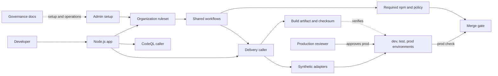
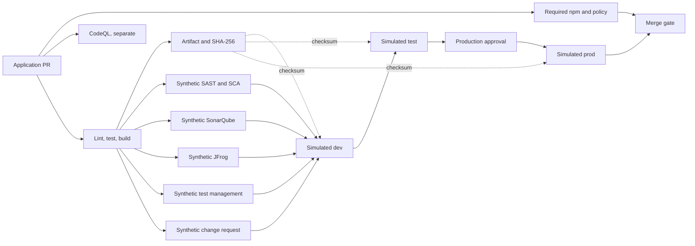

# CI/CD delivery demo

This example shows how an organization can govern a Node.js application with
shared GitHub Actions workflows, required checks, and simulated promotion
through `dev`, `test`, and `prod`. The default path needs no external vendor
accounts or deployment secrets.

**The vendor, QA, change-management, and deployment results are simulated.**
They are not real scans, approvals, registry publication, or deployments.
The independent GitHub CodeQL workflow performs actual code scanning when
enabled and entitled.

## Architecture



The [organization ruleset](docs/architecture.md) requires npm, organization
policy, and the simulated production check. CodeQL is a separate caller, not
an organization-required workflow. The `--approver` user reviews simulated
production; the baseline allows self-approval. The
[admin repository](https://github.com/cicd-demo-org/admin) configures the
ruleset and environments; the
[organization profile](https://github.com/cicd-demo-org/.github) supplies
templates and security guidance.

## Default delivery flow



Each environment verifies the same artifact checksum. Failed prerequisites,
missing artifacts, an invalid `DEMO_MODE`, checksum errors, or pending
production approval stop progression. Checksums demonstrate transfer
integrity, not trusted provenance. The synthetic adapters never contact
external systems or authorize a real release.

## Current status and guides

The optional [GHCR and Docker example](docs/real-deployment.md) is separate
from the default simulation. It includes image attestations, a protected
environment, a restricted self-hosted runner, and rollback logic; the real
runner, environment, and opt-in variable are not provisioned by default, and
live deployment and rollback have not been verified end to end. Real vendor,
QA, and change-management integrations are [replacement guidance](docs/replace-integrations.md),
not implemented controls.

Start with the [overview](docs/index.md), then see
[architecture and gates](docs/architecture.md),
[reproduction](docs/reproduce.md),
[the post-setup checklist](docs/post-setup-checklist.md),
[operations](docs/operations.md), and [implementation status](docs/status.md).

To build the documentation site:

```sh
python3 -m pip install -r requirements-docs.txt
mkdocs build --strict
```
